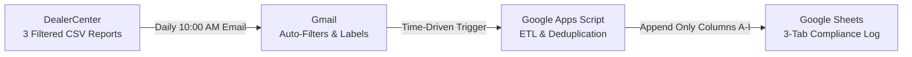

# DealerCenter Multi-Stream Tag & Compliance ETL Pipeline

A zero-cost, serverless ETL (Extract, Transform, Load) pipeline built with **Google Apps Script (JavaScript)**, **Gmail Filters**, and **Google Sheets** to automate daily automotive tag and title compliance logging from DealerCenter.

---

## The Problem
Logging vehicle tags for state compliance (PennDOT / PA Passenger, PA Trucks, and Out-of-State Temp Tags) required manually re-entering 17+ fields such as customer info, cosigner info, full addresses, insurance details, and VINs from DealerCenter into separate spreadsheets. Because DealerCenter does not provide a public API or native Zapier integration, manual entry was slow, repetitive, and prone to transcription errors.

## The Solution
I engineered a fully automated, event-routed ETL pipeline with **$0 software cost** that extracts daily filtered CSV reports from DealerCenter, routes them via Gmail labels, transforms and normalizes the schema in Google Apps Script, and loads deduplicated records into a centralized 3-tab Google Sheet.

### Architecture

---

## Multi-Stream Routing Configuration
A single config-driven `ROUTES` array maps each incoming compliance stream to its dedicated destination tab:

| Compliance Stream | DealerCenter Filter Rules | Gmail Label | Destination Tab |
| :--- | :--- | :--- | :--- |
| **PA Passenger** | Exclude Wholesale, `State = PA`, Exclude Pickups | `DealerCenter-PA-Passenger` | `PA Passenger` |
| **PA Trucks** | Exclude Wholesale, `State = PA`, Pickups Only | `DealerCenter-PA-Trucks` | `PA Trucks` |
| **Out of State** | Exclude Wholesale, `State != PA` | `DealerCenter-OutOfState` | `Out of State` |

---

## Key Engineering & Data Integrity Highlights

* **17-to-9 Column Schema Normalization:** Parses 17 raw CSV fields (split signer/cosigner names and 4-part addresses) into 9 clean, human-readable columns—merging names and formatting mailing addresses as `Street, City, State Zip` while cleanly handling deals with or without cosigners.
* **Composite-Key Deduplication:** Generates an in-memory `Set` of `VIN Last Six | Customer Name` keys on every run so overlapping daily exports never create duplicate rows.
* **Leading-Zero Preservation:** Explicitly applies plain-text formatting (`@`) to Tag, Policy Number, and VIN Last Six columns prior to writing so Google Sheets never strips leading zeros.
* **Non-Destructive Schema Design:** Isolates automated script writes to **Columns A–I**, reserving **Column J (`Title Number`)** exclusively for manual entry so daily runs never overwrite human-entered compliance data.
* **Idempotent Email Processing:** Queries only `is:unread` threads per label and marks threads as read only after successful ingestion.
* **Role-Based Access Control (RBAC) & Cell Governance:** Configured range-level sheet protections across all three compliance tabs so automated ingestion columns (**A–I**) are locked to the script owner, while leaving **Column J (`Title Number`)** unlocked and plain-text formatted for manual staff entry.
---

## Target Sheet Schema (Columns A–J)

| Col | Field | Source |
| :--- | :--- | :--- |
| **A** | Date | Automated (DealerCenter) |
| **B** | Tag | Automated (Plain Text) |
| **C** | Customer Name | Transformed (`First + Last`) |
| **D** | Customer Address | Transformed (`Street, City, State Zip`) |
| **E** | Cosigner Name | Transformed (`First + Last`, optional) |
| **F** | Cosigner Address | Transformed (`Street, City, State Zip`, optional) |
| **G** | Insurance Name | Automated (DealerCenter) |
| **H** | Insurance Policy Number | Automated (Plain Text) |
| **I** | VIN Last Six | Automated (Plain Text) |
| **J** | Title Number | **Manual Entry** (Protected) |

---

## Tech Stack
* **Language:** JavaScript (Google Apps Script)
* **Data Source:** DealerCenter Custom Scheduled CSV Reports
* **Routing / Ingestion:** Gmail Filters & Labels (`GmailApp`)
* **Destination:** Google Sheets (`SpreadsheetApp`)
* **Scheduling:** Google Apps Script Time-Driven Daily Trigger

---

## Setup & Deployment
1. **DealerCenter:** Create three Custom Deal Reports matching the 17-column layout and schedule daily CSV email delivery (e.g., 10:00 AM).
2. **Gmail:** Create filters matching each report's subject line to apply its corresponding label (`DealerCenter-PA-Passenger`, `DealerCenter-PA-Trucks`, `DealerCenter-OutOfState`). Leave emails **unread**.
3. **Google Sheets:** Create a workbook with three tabs (`PA Passenger`, `PA Trucks`, `Out of State`) and add Columns A–J headers to Row 1.
4. **Apps Script:** Open **Extensions → Apps Script**, paste `Code.gs`, authorize Gmail/Sheets permissions, and add a **Time-driven → Day timer** trigger (e.g., `10am to 11am`) targeting `importDealerCenterTags`.

---

## Pipeline Walkthrough & Proof of Execution

### 1. Normalized 3-Tab Output Schema (Sanitized Dummy Data)
> *Demonstrates 17-to-9 column normalization, optional cosigner handling, and leading-zero preservation across Policy Numbers and Title Numbers.*

### 2. Role-Based Access Control (RBAC) & Cell Protection
> *Non-owner accounts are blocked from modifying automated columns (A–I) while retaining edit access to Column J (`Title Number`).*

### 3. Serverless Automation & Execution Logs
> *Daily time-driven trigger (`10:00 AM – 11:00 AM`) with failure alerts and consecutive 2–4 second production runs.*

